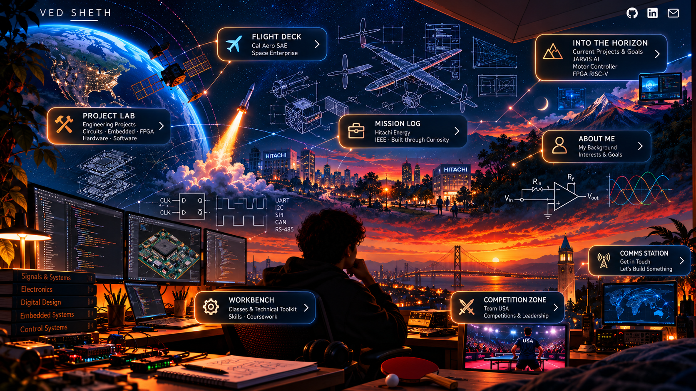

# Ventacularity — Ved Sheth's Portfolio

An interactive, illustrated portfolio exploring my work in **electrical engineering, embedded hardware, avionics, digital systems, and signal processing**, alongside my experience as a **Team USA table tennis athlete**.

I'm an Electrical Engineering and Computer Sciences student at **UC Berkeley** (Class of 2027). I built this site as a more personal way to share the projects, teams, experiences, and interests that shape my work.



## Built with

- **Next.js** (App Router), **React**, and **TypeScript**
- Custom responsive CSS, illustrated navigation hotspots, and accessible page layouts
- Project diagrams, engineering photography, embedded video, and an in-page image lightbox
- Static export for straightforward deployment

## Run locally

Requires Node.js and npm.

```bash
git clone https://github.com/Ventacularity/Ved-Sheth-Personal-Website.git
cd Ved-Sheth-Personal-Website
npm install
npm run dev
```

Visit [http://localhost:3000](http://localhost:3000).

To create a production static export:

```bash
npm run build
```

The generated files are written to `out/`.

## Project structure

```text
app/                  Pages for the eight portfolio stations
components/           Shared UI and image lightbox
lib/content.ts        Portfolio content and project metadata
public/               Homepage artwork, project media, photos, and videos
app/globals.css       Visual design and responsive styling
```

## Deployment

The site is deployed through **Vercel**, connected to the repository's `main` branch. Merging or pushing changes to `main` triggers a new production deployment.

For development, use a feature branch and open a pull request into `main` when changes are ready.

## Connect

- [GitHub](https://github.com/Ventacularity)
- [LinkedIn](https://www.linkedin.com/in/vedsheth/)
- [Email](mailto:ventacularity@berkeley.edu)

---

© Ved Sheth · UC Berkeley EECS 2027
